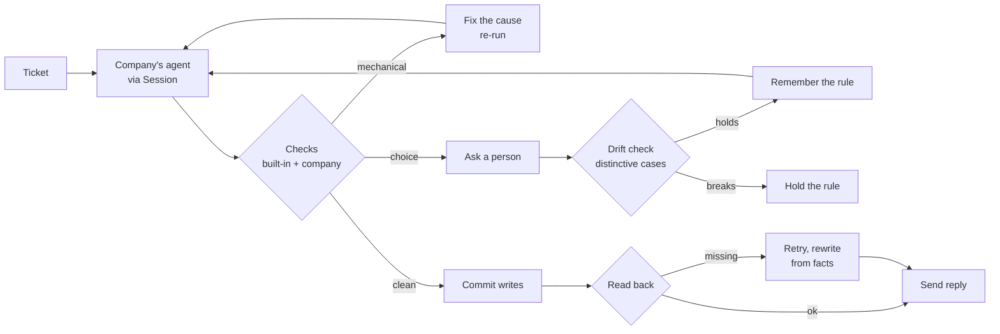

# Once


**Fixes what's mechanical. Asks what's a choice. Only needs you once.**

An AI agent that takes actions will, sooner or later, tell a customer "your address is updated" when the write failed, or refund $249 under a policy that was replaced months ago.
Once is the layer a company puts its existing agent behind: every claim and every action is checked against the company's real systems before anything reaches the customer.
Mechanical failures get fixed and verified automatically.
Real business decisions go to a person, once, and become rules the agent follows from then on.

Repo: https://github.com/Saber1Y/Once · Demo company: ACME, the fictional store from neatlogs' own `support-copilot-demo-kb` fixture · Evidence: [live run](docs/evidence/live-run-2026-10-11.md), [claims.yaml](claims.yaml)

[See it run](#see-it-run) · [Integrate an agent](#integrate-an-agent) · [How the loop works](#how-the-loop-works) · [Honesty table](#whats-real-vs-pending---the-honesty-table) · [Demo flow](#the-demo-flow)

Built for neatHack 2026, the "build an agent that works" track. MIT licensed.
ACME runs on fixture data; nothing here touches real customers, orders or payments.

## Table of contents

- [The problem, in one ticket](#the-problem-in-one-ticket)
- [See it run](#see-it-run)
- [The one rule](#the-one-rule)
- [Integrate an agent](#integrate-an-agent)
- [How the loop works](#how-the-loop-works)
  - [Check](#check)
  - [Fix what's mechanical](#fix-whats-mechanical)
  - [Ask what's a choice](#ask-whats-a-choice)
  - [Remember](#remember)
  - [Guard against drift](#guard-against-drift)
- [Architecture](#architecture)
- [Component by component](#component-by-component)
- [Safety, enforced in code](#safety-enforced-in-code)
- [Built with neatlogs, Entire and cfo.ai](#built-with-neatlogs-entire-and-cfoai)
- [Engineering decisions & the hard problems](#engineering-decisions--the-hard-problems)
- [What's real vs pending - the honesty table](#whats-real-vs-pending---the-honesty-table)
- [Tests](#tests)
- [Run it locally](#run-it-locally)
- [The demo flow](#the-demo-flow)
- [Configuration](#configuration)
- [Project layout](#project-layout)
- [Tech stack, credits, roadmap](#tech-stack-credits-roadmap)
- [Disclaimer & license](#disclaimer--license)

## The problem, in one ticket

Ticket T-102 from the live run: a customer asks for a refund on headphones bought 20 days ago.

```text
attempt 1   search_kb       → "Refund Policy" (refund-policy-v2.1, 30 days)
            propose_refund  → O-5002, $249.00
            draft           → "You're within our 30-day window, I've processed a full refund of $249.00"

Once        outdated_source → the live help center marks v2.1 outdated, superseded by v3.0 (14 days)
            wrong_outcome   → 20 days is past the current window; expected decline
            fix             → repaired the search index, re-ran the agent with the correction

attempt 2   draft           → "Our refund policy is 14 days ... I'm unable to process a refund"
            nothing wrong was committed; fix verified by the re-run
```

That outdated policy isn't invented for this demo.
neatlogs seeds their own demo with it to manufacture a regression.
Their manifesto names the gap Once fills: "seeing isn't fixing."

## See it run

```bash
cd Once && cp .env.example .env  # add a model key (any OpenAI-compatible endpoint) and your neatlogs key
make install && make serve       # console on http://127.0.0.1:8787
```

Open **Integration** to see the one file that connects ACME's agent, then open the **ACME desk** and press **Run queue**.
Two tickets fail on purpose and get fixed, one stops and asks you, and a later one is resolved with your answer without asking again.

## The one rule

**Nothing reaches the customer, and nothing irreversible happens, until it has been checked against what is actually true.**

1. *Staged writes.* The agent can only propose actions; Once commits them after the checks pass.
2. *Read-back.* Every committed write is read back from the system of record. "Accepted" is not "done".
3. *Current truth.* Policy comes from the live help center, following superseded-by links, never from whatever the agent happened to retrieve.

## Integrate an agent

A company connects in one file.
This is ACME's, abridged from [examples/acme/integration.py](examples/acme/integration.py):

```python
from once import Guard, PolicyMemory

def create_guard(memory: PolicyMemory, env=None) -> Guard:
    guard = Guard("ACME", memory, config=CONFIG)

    # 1. The help center, so Once can tell current articles from outdated ones.
    guard.sources = HelpCenterSources(env.kb, env.index)

    # 2. ACME's existing agent.
    guard.agent(lambda session: run_agent(session, env))

    # 3. Every write the agent may propose, with a read-back from the order system.
    @guard.action("address_change", verify=address_landed, validate=order_exists)
    def address_change(order_id: str, new_address: str) -> dict:
        return env.world.request_address_change(order_id, new_address)

    # 4. ACME's business checks.
    guard.check(refund_policy)
    guard.check(plan_promises)

    # 5. Trade-offs ACME chose on purpose, replayed before any new rule goes live.
    register_cases(guard)
    return guard
```

Inside the agent, the only Once-specific code is how tools are called:

```python
session.call("search_kb", lambda: index.search(query), {"query": query}, kind="source")  # read
session.propose("refund", order_id="O-5002", amount=249.0, reason="fit")                # staged write
session.ask("Refund a loyal customer 2 days late?", ["Refund", "Decline"])               # human decision
```

The console's **Integration** screen shows exactly this: the connected company, the systems Once reads, its choice boundary, its writes and read-backs, its checks next to Once's built-in ones, its distinctive cases, and its source files.

## How the loop works



### Check

| Check | Owner | Catches | Category |
| --- | --- | --- | --- |
| `outdated_source` | Once | The answer rests on a help-center article marked outdated | context |
| `side_effect_missing` | Once | A write was accepted but reading it back shows it never landed | execution |
| `unsupported_amount` | Once | The reply states an amount no tool returned | context |
| `needless_escalation` | Once | The agent asked a person about something no check calls a choice, or a rule already covers | trajectory |
| `no_reply` | Once | The agent crashed or never finished | trajectory |
| tier-2 judge | Once | Unsupported specifics, only when nothing deterministic fired | context |
| `refund_policy` | ACME | Refunds against the current policy, remembered rules and ACME's choice boundary | decision |
| `plan_promises` | ACME | A phone call promised to a Starter-plan customer | decision |

Categories are the four clusters from neatlogs' [How to read a trace](https://neatlogs.com/blog/how-to-read-a-trace).
Deterministic checks decide almost everything; the model judge grades the fewest traces, as neatlogs argues [here](https://neatlogs.com/blog/your-strongest-llm-judge-should-grade-the-fewest-traces).

### Fix what's mechanical

- Outdated source: Once repairs the company's search index, so later tickets don't hit it either.
- Write that didn't land: Once retries, reads it back with the action's `verify`, and rewrites the reply from verified facts.
- Anything else a check flags: the check supplies a precise `correction`, and Once re-runs the agent before anything is committed.

A fix counts as verified only when the re-run passes the checks that failed, or the write reads back correctly.

### Ask what's a choice

A check returns a `Choice`: a question, the facts, the options and a suggested rule scope.
Once pauses the ticket and shows the decision-maker a plain card with only the trace steps that matter.
This follows neatlogs' own answer to [self-healing is self-defeating](https://neatlogs.com/blog/self-healing-is-self-defeating): automate what isn't a choice, ask when it is, remember the answer.

### Remember

Answers become versioned rules over facts, for example `refund_exception: tenure_years >= 2 and days_over <= 7 -> refund`, stored per company in `data/tenants/<company>/policies.json` and `.yaml`.
Checks call `memory.lookup(domain, facts)` first, so the next matching ticket is resolved without asking.

### Guard against drift

Before a rule is saved, Once replays the company's distinctive cases, each against a fresh copy of its systems.
A rule that breaks one is held, with the failing cases shown on the card.
In the live run, a too-broad rule ("refund anyone up to 30 days late") was held because it refunded a two-month-old customer ($45) and a very late order ($75).

## Architecture

Two decisions shape everything:

1. **The product and the customer are separate.** `src/once` is the layer; `examples/acme` is a company integrating it. Entire's code graph confirms no calls or imports go from Once into ACME.
2. **Checks trust the system of record, not the agent**: the live help center for policy, the order system for writes.

| Tier | Runs | Can it move money? | Responsibility |
| --- | --- | --- | --- |
| Company agent | Its own model and prompts | No, it only proposes | Resolve the ticket |
| Checks | Deterministic code, tier-2 judge rarely | No | Decide what's true |
| Loop | Worker thread | Yes, through registered actions, after checks pass | Commit, verify, fix, route |
| Desk / API | FastAPI | No | Queue, decisions, integration view, events |
| Console | React | No | Show the loop, collect decisions |

## Component by component

| Module | Responsibility |
| --- | --- |
| `src/once/core.py` | The SDK: `Guard`, `Session`, `Finding`, `Choice` |
| `src/once/checks.py` | Built-in checks and the check runner |
| `src/once/loop.py` | Act, check, fix, ask, commit, verify |
| `src/once/memory.py` | Versioned rules over facts |
| `src/once/drift.py` | Parallel replay of a company's distinctive cases |
| `src/once/integrations.py` | Loads a company's integration module |
| `src/once/desk.py`, `api.py` | Worker, decisions, REST and server-sent events |
| `src/once/tracing.py`, `llm.py` | neatlogs wiring, rate-limited OpenAI-compatible client |
| `examples/acme/integration.py` | ACME's integration, in five steps |
| `examples/acme/agent.py` | ACME's own support agent |
| `examples/acme/checks.py`, `cases.py` | ACME's business checks and distinctive cases |
| `examples/acme/world.py`, `helpcenter.py` | ACME's order system (fixture) and help center (live neatlogs fixture) |
| `web/src` | Console: desk, decision cards, policy memory, drift board, integration screen |

## Safety, enforced in code

| Claim | How it's enforced |
| --- | --- |
| The agent can't run arbitrary writes | Only actions registered with `@guard.action` can be staged; anything else is rejected |
| No wrong refund is committed | Writes are staged; `refund_policy` re-runs the agent before commit |
| No "done" for undone work | Every action's `verify` reads the write back; replies are rewritten from verified facts |
| No outdated policy | Every source the agent used is checked against its live status |
| Refunds can't exceed the order | ACME's order system rejects amounts above the refundable balance |
| Rules can't silently erode trade-offs | Candidate rules run the drift check and are held on any failure |

## Built with neatlogs, Entire and cfo.ai

### neatlogs

- Every ticket is one `WORKFLOW` trace: the company's agent is an `AGENT` span, its tools are `TOOL` spans, Once's checks and fixes are `CHAIN` spans, and every model call is captured through `neatlogs.wrap`.
- The failed attempt and the fixed one sit side by side in the same trace; the console links each ticket to it.
- The product is built around the problems neatlogs has written about: [seeing isn't fixing](https://neatlogs.com/manifesto), [self-healing is self-defeating](https://neatlogs.com/blog/self-healing-is-self-defeating), the detection gap where an agent "confirmed an update after the write failed", and grading with the cheapest judge that works.

### Entire

- Entire is enabled on the repository for Claude Code; checkpoints of the build sessions are pushed with each commit under `refs/entire/checkpoints/` (19 on `main` at the time of writing).

```bash
entire checkpoint list              # checkpoints tied to commits
entire checkpoint explain <sha>     # the session behind a commit, e.g. the grace-period fix
```

- `entire graph` was used to audit the product boundary: across 627 symbols and 2,048 relations, ACME depends on Once's SDK (`Guard`, `Session`, `Finding`, `Choice`, `PolicyMemory`), and nothing in `src/once` calls or imports ACME. The audit found one real leak, an ACME-specific CLI command inside the product, which was removed.

### cfo.ai

The business plan (price per verified resolution, inference cost per ticket, margin) is being modelled in cfo.ai and will be committed as `docs/business-plan.md`.

## Engineering decisions & the hard problems

**A layer has to be honest about what it can't know.**
Once can't know a company's refund policy, so business rules are the company's checks; Once supplies the loop, the generic checks, the memory and the drift replay.

**Async writes make the lie realistic.**
ACME's address service returns `accepted` and applies the change in a background job, like many real APIs.
An injected fault makes the first job fail, so the agent's natural "your address is updated" becomes a false claim that only read-back can catch.

**Rules are facts, not prose.**
A remembered decision is a set of conditions over facts the check provides, so it matches deterministically and can be replayed against distinctive cases before it goes live.

**The live run tested the tests.**
With a rule in place, ACME's own window check misread "a 7-day grace period" as a wrong refund window and blocked a correct reply four times.
The fix and a regression test are in [the evidence file](docs/evidence/live-run-2026-10-11.md).

## What's real vs pending - the honesty table

| Capability | Status |
| --- | --- |
| Once SDK, checks, loop, memory, drift | Real - unit-tested against a toy company and against ACME |
| End-to-end runs with a real model | Real - Gemini via its OpenAI-compatible endpoint, traced in neatlogs ([evidence](docs/evidence/live-run-2026-10-11.md)) |
| ACME help center | Real - live neatlogs fixture pages, cached for offline runs |
| ACME orders, customers, refunds | Fixture data in SQLite, labelled as such |
| Failed address write on T-101 and D6 | Injected fault, labelled in the console |
| neatlogs trace export | Real when `NEATLOGS_API_KEY` is set; otherwise spans stay local and the console says so |
| Entire checkpoints and graph audit | Real - checkpoints pushed with commits; graph audit run on this tree |
| neatlogs trace deep links | Not yet established - dashboard route is configurable via `NEATLOGS_TRACE_URL` |
| Trace readback via the neatlogs Public API | Not yet established |
| Real helpdesk and commerce connectors | Not yet established - ACME's systems are fixtures |
| Run against the neatHack LiteLLM proxy | Not yet established - same code path, pending the team key |
| cfo.ai business plan | Not yet established - in progress |

Tier-2 judge rewrites are recorded as unverified fixes, because nothing independently re-checks the judge's own claim.

## Tests

| Suite | Tests | Covers |
| --- | --- | --- |
| `tests/test_once.py` | 6 | Built-in checks, choice routing, read-back, unregistered actions and fact-based memory, against a toy company |
| `tests/test_acme.py` | 9 | ACME's help center, order system, refund policy, choice then rule, plan promises, failed address write, window check |

```bash
cd Once && make test  # pytest
cd Once && make lint  # ruff, eslint, tsc
```

Live-model checks: `make demo` (headless queue), `make drift` (distinctive cases), `make repeat` (outdated-policy appear and catch rate over 10 runs).

## Run it locally

### 1. Backend

```bash
cd Once
uv sync
cp .env.example .env     # fill in keys
uv run once integration  # what ACME registered: actions, checks, cases
uv run once serve        # http://127.0.0.1:8787
```

### 2. Console

```bash
cd Once/web
npm ci
npm run build  # served by the backend, or:
npm run dev    # http://localhost:5173
```

### 3. Headless

```bash
cd Once
uv run once demo T-101 T-102  # run selected tickets and print the loop
uv run once drift             # replay ACME's distinctive cases
```

## The demo flow

1. Press **Reset** for a clean start.
2. Open **Integration**: ACME is connected, and the five steps are highlighted in `integration.py`.
3. Open the **ACME desk**, select **T-101** and press **Run ticket**: the agent drafts "address updated", read-back shows the write failed (injected fault), and Once retries, verifies and rewrites the reply.
4. **T-102**: the agent answers from the outdated 30-day policy and proposes a $249 refund; Once blocks it, repairs the index and re-runs under the current 14-day policy.
5. **T-103**: a four-year customer two days past the window; a card appears under **Needs you**.
6. Choose **Refund in full**, keep **Make it a rule**, press **Decide and remember**; the drift check replays six cases and saves rule v1.
7. **T-109**: a three-year customer four days late; resolved with your rule and no card.
8. Optional: answer a decision with 0 years and 30 days and watch the drift check hold it.

## Configuration

| Variable | Purpose |
| --- | --- |
| `ONCE_INTEGRATION` | Integration module (default `acme.integration`) |
| `LLM_BASE_URL` | OpenAI-compatible endpoint (LiteLLM proxy, Gemini, ...) |
| `LLM_API_KEY` | Model key |
| `ONCE_MODEL` | Model for the agent and rewrites |
| `ONCE_JUDGE_MODEL` | Cheaper model for the tier-2 judge (defaults to `ONCE_MODEL`) |
| `LLM_RPM` | Client-side requests per minute per model (0 = unlimited) |
| `NEATLOGS_API_KEY` | neatlogs project key; without it traces stay local |
| `NEATLOGS_TRACE_URL` | Optional trace link template, for example `https://app.neatlogs.com/...{trace_id}` |

## Project layout

```text
Once/
├── src/once/             # the product
│   ├── core.py           # SDK: Guard, Session, Finding, Choice
│   ├── checks.py         # built-in checks
│   ├── loop.py           # act, check, fix, ask, commit, verify
│   ├── memory.py         # rules over facts
│   ├── drift.py          # distinctive-case replay
│   ├── integrations.py   # load a company's integration
│   ├── desk.py, api.py   # worker, decisions, HTTP and SSE
│   └── tracing.py, llm.py
├── examples/acme/        # a customer
│   ├── integration.py    # the five-step integration
│   ├── once.yaml         # ACME's config and choice boundary
│   ├── agent.py          # ACME's own agent
│   ├── checks.py, cases.py
│   ├── world.py, helpcenter.py
│   └── data/             # fixture orders, faults, demo tickets
├── tests/                # product tests and ACME tests
├── docs/                 # PRD and evidence
└── web/                  # React console
```

## Tech stack, credits, roadmap

### Tech stack

Python 3.13, neatlogs SDK, OpenAI SDK (any OpenAI-compatible endpoint), FastAPI, SQLite, React 19, Vite, Tailwind CSS 4, Motion, Phosphor icons, IBM Plex Sans and Mono.

### Credits

The ACME help center is neatlogs' public `support-copilot-demo-kb` fixture.
The failure taxonomy and the "ask once, remember" loop follow ideas neatlogs published on their blog.

### Roadmap

- Design partners: support teams already running an AI agent, with Shopify, Stripe and Zendesk connectors.
- A decision inbox in Slack and Teams, so decision-makers never open a dashboard.
- A TypeScript SDK and helpdesk marketplace apps.
- Beyond support: finance ops, IT helpdesk and any agent that issues refunds, credits, access or orders.
- Trace readback through the neatlogs Public API as the verification source.

## Disclaimer & license

Once is a hackathon project; the demo company ACME runs on fixture data, and nothing here processes real customers, orders or payments or gives legal or financial advice.

**MIT License.**
