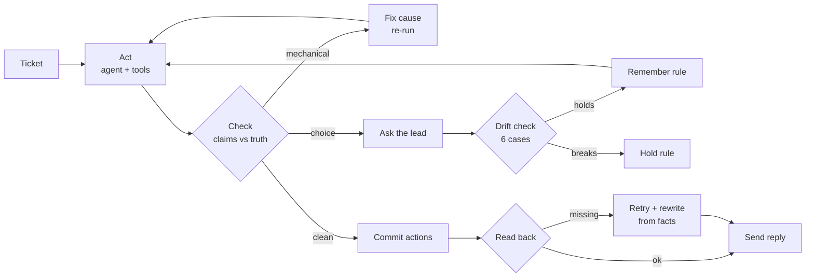

# Once


**Fixes what's mechanical. Asks what's a choice. Only needs you once.**

Support agents fail quietly: they confirm updates that never landed, answer from outdated policy, and promise things the customer's plan doesn't include.
Self-healing loops that auto-fix everything make it worse, because they slowly erase the trade-offs that make a company distinctive.
Once is a support agent that checks every claim against what its tools actually returned, fixes the mechanical failures itself, asks a human only when a failure is really a business choice, and remembers the answer so it never asks twice.

Repo: https://github.com/Saber1Y/Once · Knowledge base: the public neatlogs `support-copilot-demo-kb` fixture.

[See it in one command](#see-it-in-one-command) · [The one rule](#the-one-rule) · [Architecture](#architecture) · [Honesty table](#whats-real-vs-pending---the-honesty-table) · [The one-flow demo](#the-one-flow-demo)

Built for neatHack 2026 (single track: build an agent that works). MIT licensed.
ACME is a fictional store; nothing here processes real customers or real payments.

## Table of contents

- [See it in one command](#see-it-in-one-command)
- [Screenshots](#screenshots)
- [The one rule](#the-one-rule)
- [What Once does](#what-once-does)
  - [Act](#act)
  - [Check](#check)
  - [Fix what's mechanical](#fix-whats-mechanical)
  - [Ask what's a choice](#ask-whats-a-choice)
  - [Remember](#remember)
  - [Guard against drift](#guard-against-drift)
- [Architecture](#architecture)
- [Component by component](#component-by-component)
- [Safety, enforced in code](#safety-enforced-in-code)
- [How it uses neatlogs, Entire and cfo.ai](#how-it-uses-neatlogs-entire-and-cfoai)
- [Engineering decisions & the hard problems](#engineering-decisions--the-hard-problems)
- [What's real vs pending - the honesty table](#whats-real-vs-pending---the-honesty-table)
- [Tests](#tests)
- [Run it locally](#run-it-locally)
- [The one-flow demo](#the-one-flow-demo)
- [Configuration](#configuration)
- [Project layout](#project-layout)
- [Tech stack, credits, roadmap](#tech-stack-credits-roadmap)
- [Disclaimer & license](#disclaimer--license)

## See it in one command

```bash
cd Once && cp .env.example .env  # add your LiteLLM key, model and neatlogs key
make install && make serve       # console on http://127.0.0.1:8787
```

```bash
cd Once && make dev  # optional: Vite dev server on :5173, proxies /api to :8787
```

Open the console, press **Run queue**, and watch ten ACME tickets resolve.
Two of them fail on purpose and get fixed, one stops and asks you, and a later one is resolved with your answer without asking again.

## Screenshots

The demo video shows the console live.
The first traced run, with trace ids, drift results and the held rule, is written up in [docs/evidence/live-run-2026-10-11.md](docs/evidence/live-run-2026-10-11.md), and every claim maps to evidence in [claims.yaml](claims.yaml).

## The one rule

**Nothing reaches the customer, and nothing irreversible happens, until it has been checked against what is actually true.**

1. *Staged actions.* The agent proposes refunds, credits and address changes; the loop commits them only after the pre-commit checks pass.
2. *Read-back verification.* After commit, side effects are read back from the system of record. "Accepted" is not "done".
3. *Current truth, not retrieved truth.* Policy checks use the live help center and follow superseded-by links, never whatever the agent happened to retrieve.

## What Once does

### Act

A tool-calling support agent (`src/once/agent.py`) looks up the customer and order, searches the knowledge base, proposes actions and drafts a reply.

```text
lookup_customer → get_order → search_kb → propose_refund → draft reply
```

Every tool call is a neatlogs `TOOL` span inside the attempt's `AGENT` span, inside the ticket's `WORKFLOW` trace.

### Check

`src/once/checker.py` compares the draft and the proposed actions with the tool results and the current policy.

| Check | Catches | Category |
| --- | --- | --- |
| `stale_source` | Answered from an article the live help center marks outdated | context |
| `wrong_outcome` | Refund proposed or refused against current policy or a remembered rule | decision |
| `forbidden_promise` | A phone call promised to a Starter-plan customer | decision |
| `wrong_window` / `unsupported_amount` | Numbers no tool returned | context |
| `side_effect_missing` | A write that was accepted but never applied, often with a "done!" reply | execution |
| `needless_escalation` | Asking a human about a case policy already covers | trajectory |
| tier-2 judge | Unsupported specifics, only when deterministic checks find nothing and the draft contains numbers | context |

Categories are the four clusters from neatlogs' [How to read a trace](https://neatlogs.com/blog/how-to-read-a-trace).
Deterministic checks decide almost everything; the model judge grades the fewest traces, as neatlogs argues [here](https://neatlogs.com/blog/your-strongest-llm-judge-should-grade-the-fewest-traces).

### Fix what's mechanical

`src/once/loop.py` fixes the cause, re-runs, and verifies:

- Outdated source: repairs the search index (replaces `refund-policy-v2.1` with `refund-policy-v3.0`), so later tickets don't hit it either.
- Failed write: retries, reads the order back, and rewrites the reply from verified facts.
- Wrong outcome, amount, window or promise: re-runs the agent with a precise correction, before anything is committed.

A fix counts as verified only when the re-run passes the checks that failed, or the side effect reads back correctly.

### Ask what's a choice

ACME's choice boundary lives in `src/once/policy.py`: a refund just past the window for a long-standing customer is a business decision, not a bug.
Once pauses the ticket and shows the support lead a plain-language card with only the trace steps that matter, three options, and an adjustable scope.

### Remember

Answers become versioned rules in `data/policies.json` (exported to `data/policies.yaml`).
The next matching ticket is resolved with the rule applied and no question asked.

### Guard against drift

Before a rule is saved, `src/once/drift.py` replays six distinctive cases, each in its own fresh world.
A rule that breaks one (for example "refund anyone, any time") is held, with the failing cases shown on the card.

## Architecture

Two decisions shape everything:

1. **One ticket is one neatlogs trace**, with each attempt as an `AGENT` span, so the failed attempt and the fixed one sit side by side.
2. **The checker trusts the system of record, not the agent**: the live help center for policy, the order store for side effects.



| Tier | Runs | Can it move money? | Responsibility |
| --- | --- | --- | --- |
| Agent | LiteLLM model with tools | No, it only proposes | Resolve the ticket |
| Checker | Deterministic code, tier-2 judge rarely | No | Decide what's true |
| Loop | Worker thread | Yes, after checks pass | Commit, verify, fix, route |
| Desk / API | FastAPI | No | Queue, decisions, events |
| Console | React | No | Show the loop, collect decisions |

## Component by component

| Module | Responsibility |
| --- | --- |
| `world/kb.py` | Live neatlogs help-center pages, plus the stale-seeded search index |
| `world/store.py` | ACME fixture store: customers, orders, refunds, async address jobs with fault injection |
| `policy.py` | Current refund window, choice boundary, refund oracle, versioned policy memory |
| `agent.py` | Tool-calling support agent with staged actions |
| `checker.py` | Pre-commit and post-commit checks, tier-2 judge |
| `loop.py` | The loop: act, check, fix, ask, commit, verify |
| `drift.py` | Distinctive cases and the parallel drift replay |
| `desk.py` | Worker thread, decisions, rule lifecycle |
| `api.py` | REST + server-sent events |
| `tracing.py` | neatlogs init, trace ids, trace links |
| `web/src` | Console: queue, loop timeline, decision cards, policy memory, drift board, live log |

## Safety, enforced in code

| Claim | How it's enforced |
| --- | --- |
| No wrong refund is committed | Actions are staged; `wrong_outcome` re-runs the agent before `_commit` |
| No "done" for undone work | `after_commit` reads the order back; replies are rewritten from verified facts |
| No outdated policy | Every retrieved article is checked against its live status banner |
| No forbidden promises | `forbidden_promise` blocks callback promises for Starter customers |
| Refunds can't exceed the order | `World.refund` rejects amounts above the refundable balance |
| Rules can't silently erode trade-offs | Candidate rules run the drift check and are held on any failure |

## How it uses neatlogs, Entire and cfo.ai

- **neatlogs:** every ticket is a `WORKFLOW` trace with `AGENT`, `TOOL` and `CHAIN` spans and auto-captured LLM spans via `neatlogs.wrap`. The console links each ticket to its trace. The product itself answers neatlogs' stated open problems: [seeing isn't fixing](https://neatlogs.com/manifesto), [self-healing is self-defeating](https://neatlogs.com/blog/self-healing-is-self-defeating), and the detection gap where an agent "confirmed an update after the write failed".
- **Entire:** checkpoints capture the Claude Code sessions that built Once.
- **cfo.ai:** the business plan (price per resolved ticket, inference cost, margin) lives in `docs/business-plan.md`.

## Engineering decisions & the hard problems

**Async writes make the lie realistic.**
The address service returns `accepted` and applies the change in a background job, like many real APIs.
An injected fault makes the first job fail, so the agent's natural "your address is updated" becomes a false claim that only read-back can catch.

**The stale policy is the one neatlogs built.**
Their demo seeds retrieval with the outdated 30-day policy to manufacture a regression.
Once does the same, and catches it by checking the live page's own banner instead of trusting retrieval.

**The oracle decides policy, the model decides language.**
Whether a refund is owed is computed deterministically from the current policy and remembered rules.
The model writes the reply; the checker makes sure the reply and the actions agree with the oracle.

**Choices are bounded, not guessed.**
The escalation boundary is explicit configuration, so "ask a human" is predictable and testable.

## What's real vs pending - the honesty table

| Capability | Status |
| --- | --- |
| Knowledge base | Real - live neatlogs fixture pages, cached for offline runs |
| Orders, customers, refunds | Fixture data in SQLite, labelled as such |
| Failed address write on T-101 and D6 | Injected fault, labelled in the console |
| Model calls, checks, fixes, decisions, drift | Real on every run |
| neatlogs trace export | Real when `NEATLOGS_API_KEY` is set; otherwise spans stay local and the console says so |
| neatlogs trace deep links | Not yet established - dashboard route is configurable via `NEATLOGS_TRACE_URL` |
| Trace readback via Public API | Not yet established - planned behind `NEATLOGS_TOKEN` |
| End-to-end run with a real model | Real - Gemini via its OpenAI-compatible endpoint, traced in neatlogs ([evidence](docs/evidence/live-run-2026-10-11.md)) |
| Run against the neatHack LiteLLM proxy | Not yet established - same code path, pending the team key |
| Entire checkpoints | Real - enabled on the repo, checkpoints pushed with commits |

The core loop is implemented, unit-tested and verified in a live traced run; tier-2 judge rewrites are recorded as unverified fixes.

## Tests

| Suite | Tests | Covers |
| --- | --- | --- |
| `tests/test_core.py` | 12 | KB parsing, supersession, stale index, async address fault, refund limits, oracle, rules, every deterministic check |

```bash
cd Once && make test  # pytest
cd Once && make lint  # ruff, eslint, tsc
```

Live-model checks: `make demo` (headless queue), `make drift` (distinctive cases), `make repeat` (stale-policy appear and catch rate over 10 runs).

## Run it locally

### 1. Backend

```bash
cd Once
uv sync
cp .env.example .env  # fill in keys
uv run once kb        # sanity check: live KB as Once sees it
uv run once serve     # http://127.0.0.1:8787
```

### 2. Console

```bash
cd Once/web
npm ci
npm run build  # served by the backend, or:
npm run dev    # http://localhost:5173
```

### 3. Headless

```bash
cd Once
uv run once demo T-101 T-102  # run selected tickets and print the loop
uv run once drift             # replay distinctive cases
```

## The one-flow demo

1. Press **Run queue**.
2. T-101: the agent drafts "address updated"; read-back shows the write failed (injected fault); Once retries, verifies, and rewrites the reply.
3. T-102: the agent answers from the outdated 30-day policy; Once repairs the index and re-runs with the current 14-day policy.
4. T-103: a four-year customer two days past the window; Once asks you.
5. Answer "Refund in full", make it a rule; the drift check replays six cases and saves rule v1.
6. T-109: a three-year customer four days late; resolved with your rule, no question asked.
7. Optional: answer a decision with a too-broad rule (0 years, 30 days) and watch the drift check hold it.

## Configuration

| Variable | Purpose |
| --- | --- |
| `LLM_BASE_URL` | LiteLLM proxy URL (OpenAI-compatible) |
| `LLM_API_KEY` | LiteLLM key |
| `ONCE_MODEL` | Model for the support agent |
| `ONCE_JUDGE_MODEL` | Cheaper model for the tier-2 judge (defaults to `ONCE_MODEL`) |
| `NEATLOGS_API_KEY` | neatlogs project key; without it traces stay local |
| `NEATLOGS_TRACE_URL` | Optional trace link template, e.g. `https://app.neatlogs.com/...{trace_id}` |
| `NEATLOGS_TOKEN` / `NEATLOGS_PROJECT_ID` | Optional Public API readback |
| `ONCE_TODAY` | Pin the demo date (ISO) |

## Project layout

```text
Once/
├── data/
│   ├── world.json        # ACME fixture store and injected faults
│   └── tickets.json      # seeded demo queue
├── docs/PRD.md           # product requirements
├── src/once/
│   ├── world/            # knowledge base + fixture store
│   ├── agent.py          # support agent
│   ├── checker.py        # checks and failure taxonomy
│   ├── loop.py           # act, check, fix, ask, verify
│   ├── policy.py         # oracle, choice boundary, memory
│   ├── drift.py          # distinctive cases
│   ├── desk.py           # worker and decisions
│   └── api.py            # FastAPI + SSE
├── tests/
└── web/                  # React console
```

## Tech stack, credits, roadmap

### Tech stack

Python 3.13, neatlogs SDK, OpenAI SDK against LiteLLM, FastAPI, SQLite, React 19, Vite, Tailwind CSS 4, Motion.

### Credits

The ACME help center is neatlogs' public `support-copilot-demo-kb` fixture.
The failure taxonomy and the "ask once, remember" loop follow ideas neatlogs published on their blog.

### Roadmap

- Trace readback through the neatlogs Public API as the verification source.
- Real helpdesk adapters (Zendesk, Intercom) behind the same staged-action interface.
- Rule expiry and review, so remembered decisions get revisited.

## Disclaimer & license

Once is a hackathon project operating on a fictional store with fixture data; it does not process real customers, orders or payments, and its outputs are not legal or financial advice.

**MIT License.**
